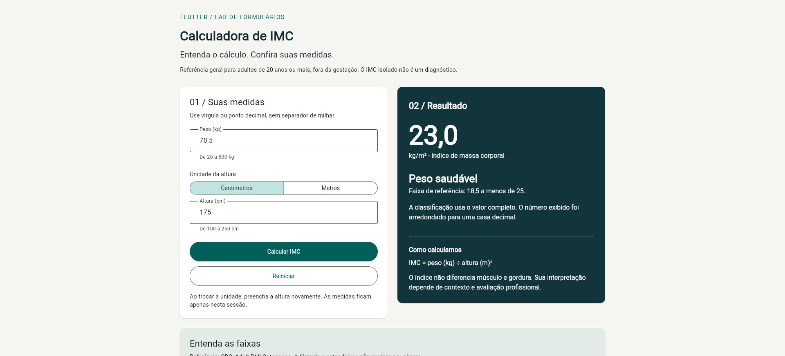

# Flutter BMI Calculator

[](https://github.com/kleberandrade/calculadora-imc-aulas-flutter/actions/workflows/ci.yml)
[](https://docs.flutter.dev/release/release-notes)
[](pubspec.yaml)
[](LICENSE)

An educational Flutter app for learning forms, validation, state, accessibility and pure domain tests. The interface is in Brazilian Portuguese; technical documentation is in English.



## Requirements and setup

Use **Flutter 3.50.0 / Dart 3.14.0**, the stable toolchain verified on November 17, 2026, and Chrome for the validated web target. No API keys, accounts, backend or Firebase are required.

```sh
git clone https://github.com/kleberandrade/calculadora-imc-aulas-flutter.git
cd calculadora-imc-aulas-flutter
flutter --version
flutter pub get --enforce-lockfile
flutter run -d chrome
```

Runtime dependencies: Flutter SDK and **material_ui 1.11.1**. Development: Flutter test SDK and **flutter_lints 6.0.0**. See [dependency constraints and SDK pins](docs/dependencies.md); do not add incompatible overrides to satisfy catalog versions.

## Use

1. Enter weight in **kg** (20–500 inclusive).
2. Select height in **cm** (100–250) or **m** (1–2.5), inclusive.
3. Enter a decimal comma or dot, e.g. `70,5` and `175`, or `70.5` and `1.75` in metre mode. Thousands separators and scientific notation are deliberately unsupported.
4. Select **Calcular IMC**, or submit the height field with the keyboard. For `70.5 kg / 1.75 m`, the displayed result is `23,0` and the general category is `Peso saudável`.
5. Correct field errors without restarting. Editing a value invalidates the previous result. Changing the height unit keeps weight and clears height/result/errors. **Reiniciar** clears both values, errors and result, restores cm, and focuses weight.

Values remain in memory for the current session. The app does not persist or transmit measurements. A web browser still downloads the application assets from whichever host serves them.

## Domain and limits

`BMI = weightKg / (heightMeters * heightMeters)`.

This example implements the [CDC general categories for adults aged 20 and older](https://www.cdc.gov/bmi/adult-calculator/bmi-categories.html), outside pregnancy. The classification is independent of gender: below 18.5; 18.5 to below 25; 25 to below 30; 30 to below 35; 35 to below 40; and 40 or higher. Classify the full numeric value; round only the display to one decimal. A rounded number at a boundary can therefore look like the adjacent category.

BMI is a screening measure, **not a diagnosis**. It does not distinguish fat and muscle and requires context. Children, teenagers and pregnancy require specific assessment; this app does not implement those criteria. The input ranges are **operational limits of this teaching example**, not medical standards or a claim that all adults fall within them. No personalized medical advice is provided. See [CDC calculation and interpretation FAQ](https://www.cdc.gov/bmi/faq/index.html).

## Architecture

- `lib/domain/bmi.dart`: immutable validated `BodyMeasurements`, explicit `HeightUnit`, and ordered `BmiCategory`. Pure Dart, no Flutter import. Parsing rejects empty, malformed, zero, negative, non-finite, overflow and out-of-range input before calculation.
- `lib/main.dart`: Material theme, form/controller lifecycle, keyboard focus, validation recovery and responsive result/reference cards. The result has a semantic live region and never relies on color alone.
- `test/bmi_test.dart`: formula, unit equivalence, parsing, range endpoints and exact category transitions.
- `test/app_test.dart`: recovery, stale-result removal, reset, unit changes, keyboard submit, narrow/large-text layout and accessibility guidelines.
- `web/`, `android/`, `ios/`: current Flutter-generated platform hosts. Both original native application identifiers are preserved.

## Verify and build

```sh
flutter pub get --enforce-lockfile
dart format --output=none --set-exit-if-changed lib test
flutter analyze
flutter test --coverage
flutter build web --release
```

Verified locally: nine tests, clean analysis, release web build, and real Chrome interactions at desktop width and a **390×844 browser viewport**. Automated widget tests also cover **360px / 200% text** and contrast, labels and Android tap-target guidelines. Browser viewport testing is not a physical phone test. Screenshots: [desktop](images/app-desktop-2026.jpg), [narrow form](images/app-mobile-2026.jpg), [narrow result](images/app-mobile-result-2026.jpg), [validation](images/app-validation-2026.jpg).

The [CI workflow](.github/workflows/ci.yml) repeats formatting, analysis, tests and release web compilation on `master`, with the lockfile enforced, and uploads the build plus raw coverage output. No deployment or package publication is configured. No coverage percentage or mutation score is claimed.

Android and iOS hosts were regenerated with Flutter 3.50, but **native builds and physical devices were not validated**. Android requires its SDK/JDK and accepted licenses; this update did not accept them. iOS requires Xcode and appropriate signing. The generated Android release configuration uses a debug key for local examples and is not a store distribution configuration.

## Migration and lesson

The 2019 Dart 2 app used unsafe `double.parse`, empty-only validation, `RaisedButton`, an incorrect 18.6 boundary and significant-digit rounding. The revision introduces null safety, current Material components, controller disposal, strict parsing and a tested domain. Obsolete native embedding/build files were replaced with current SDK templates. The old gender-based exercise was removed because it does not match the general adult classification used here. Historical screenshots and [original article content](docs/medium-original-editor.html) are retained for provenance, outside the active tutorial path.

Portuguese lesson: [Desenvolvendo meu primeiro aplicativo com Flutter](https://medium.com/@kleberandrade/desenvolvendo-meu-primeiro-aplicativo-com-flutter-918a15e73a01). See [editorial revision and publication evidence](docs/medium-update.pt-BR.md), [change log](docs/modernization-log.md) and [image provenance](images/README.md).

## License and attribution

Copyright 2019 Kleber de Oliveira Andrade. The original MIT license and authorship are preserved in [LICENSE](LICENSE). Flutter-generated assets and dependencies retain their upstream licenses; the conceptual cover is identified separately from real screenshots. No third-party material is relicensed by this revision.
