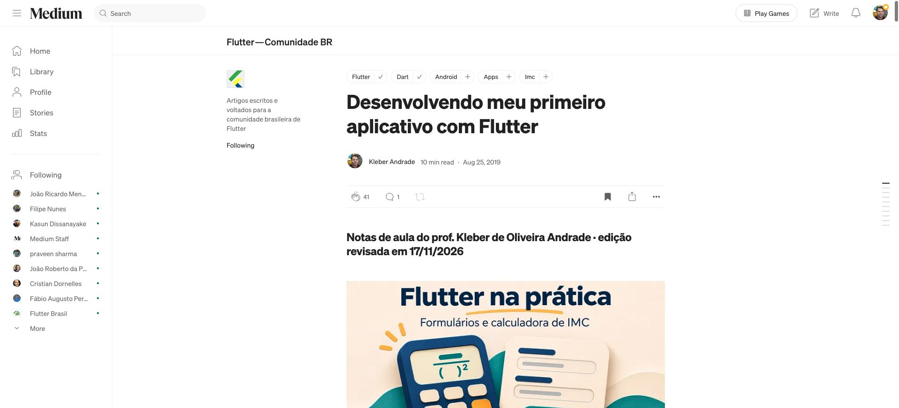
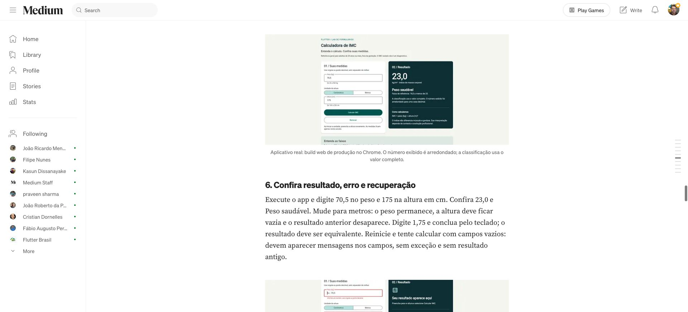
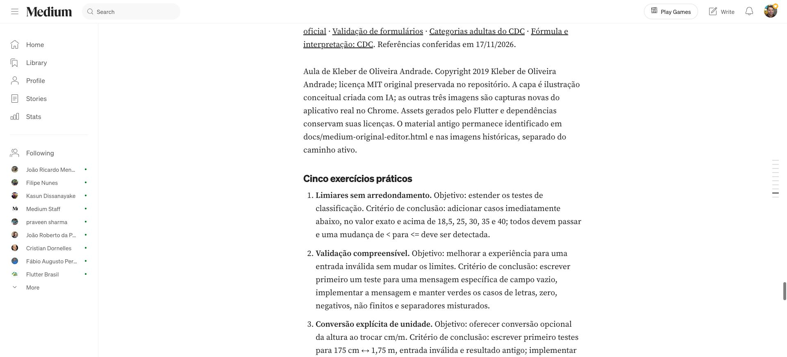

# Revisão editorial — publicada em 17/11/2026

Artigo próprio lido e editado na conta Kleber Andrade. Identidade `918a15e73a01`, título, autoria, publicação Flutter — Comunidade BR e URL original preservados:

https://medium.com/@kleberandrade/desenvolvendo-meu-primeiro-aplicativo-com-flutter-918a15e73a01

URL canônica após republicação:

https://medium.com/flutter-comunidade-br/desenvolvendo-meu-primeiro-aplicativo-com-flutter-918a15e73a01

## Revisão concluída

- Aula integralmente revisada em português: escopo adulto 20+, fórmula, categorias gerais, limites do IMC, instalação reproduzível, arquivos do projeto, widgets, domínio puro, validação, foco, ciclo de vida, resultado, recuperação, reinício e verificação.
- Flutter 3.50.0, Dart 3.14.0, material_ui 1.11.1 e flutter_lints 6.0.0 alinhados ao projeto validado. Pins transitivos do SDK explicitados sem overrides.
- Substituídos os embeds e imagens antigos no caminho ativo. O material histórico permanece em [medium-original-editor.html](medium-original-editor.html), separado da aula atual.
- Corrigidos o limite antigo de 18,6, o arredondamento excessivo e o desafio sem fundamento de alterar fórmula/classificação por gênero. Referência geral do CDC identificada, sem diagnóstico ou aconselhamento personalizado. Crianças, adolescentes e gestação não foram confundidos com o escopo adulto.
- Capa conceitual nova criada com IA, identificada na legenda e no texto alternativo. Selecionada como destaque; a página pública confirmou a mesma imagem em `og:image`.
- Três capturas novas do build web real no Chrome, com legendas e textos alternativos: resultado desktop, erros após reinício e conteúdo responsivo em viewport estreita. São capturas de navegador, não testes físicos de celular.
- Exatamente **cinco exercícios práticos finais**, cada um com objetivo e critério de conclusão. Referências e créditos aparecem antes deles.
- Clique em **Save and publish**, retorno à URL pública com `postPublishedType=repub` e verificação do conteúdo. Não houve envio de newsletter, e-mail ou mensagem a seguidores.

## Fidelidade e evidências

Os **oito blocos publicados** foram comparados com a revisão: **8/8 idênticos**, incluindo aspas, indentação e quebras de linha. Para evitar que o importador do Medium divida código em vários blocos, a versão editorial suprime linhas vazias; isso é explicitado na aula. O domínio completo é idêntico ao fonte após essa única normalização. O exemplo adicional de teste da aula foi extraído do HTML e executado com sucesso; o arquivo temporário foi removido depois.

Quatro imagens foram verificadas carregadas após rolagem, com quatro legendas e quatro textos alternativos. Título, versões e contagem de cinco itens na última seção didática também foram confirmados.

Capa de destaque pública: https://miro.medium.com/v2/resize:fit:1200/0*L5KIhvmK76kzOVM5.png

- [Revisão completa](medium-lesson.pt-BR.html)
- [Verificação estruturada da página pública](medium-published-verification.json)
- [Registro de ações e validações](modernization-log.md)

## Limites verificados

Nove testes de domínio/widgets, análise sem avisos, build web de produção e execução real no Chrome. Hosts Android/iOS atualizados, mas sem build nativo ou teste físico alegado. Ferramentas crapper/dryer/mutator sem suporte a Dart; nenhuma pontuação inventada. Valores aceitos pelo exemplo: 20–500 kg e 1–2,5 m; são limites operacionais, não critérios clínicos.
